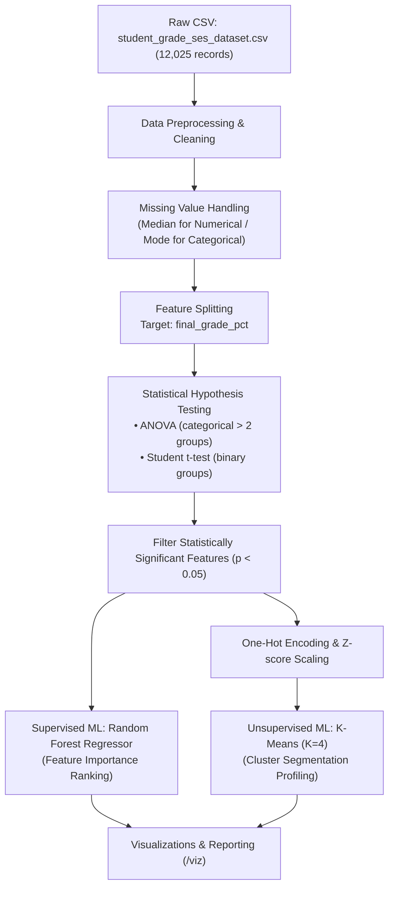

# Data Dictionary: Student Grade & Socioeconomic Status (SES)

**Dataset path:** `kaggle_projects/students_grade_database/student_grade_ses_dataset.csv`  
**Total Records:** 12,025  
**Total Features:** 29  

---

### Data Schema & Dictionary

| Column Name | Data Type | Description | Null Policy | Range / Categories |
| :--- | :--- | :--- | :--- | :--- |
| `student_id` | `str` | Unique identification code for each student | Non-nullable (0 missing) | 12,000 unique values (`STU100000`+) |
| `academic_year` | `str` | Academic school year recorded in the survey | Non-nullable (0 missing) | `2021-2022`, `2022-2023`, `2023-2024`, `2024-2025` |
| `survey_date` | `str` | Collection date of survey response | Non-nullable (0 missing) | YYYY-MM-DD (75 distinct dates) |
| `age` | `int64` | Age of student in completed years | Non-nullable (0 missing) | `[10, 18]` |
| `gender` | `str` | Student self-identified gender | Non-nullable (0 missing) | `Male`, `Female`, `Other` |
| `grade_level` | `int64` | School grade level / standard | Non-nullable (0 missing) | `[6, 12]` |
| `school_type` | `str` | Administrative type of school attended | Non-nullable (0 missing) | `Government`, `Private-Unaided`, `Government-Aided` |
| `residence_type` | `str` | Demographic classification of residence area | Non-nullable (0 missing) | `Rural`, `Urban`, `Semi-Urban` |
| `family_size` | `int64` | Total count of individuals in household | Non-nullable (0 missing) | `[2, 10]` |
| `num_siblings` | `int64` | Number of siblings living in the household | Non-nullable (0 missing) | `[0, 8]` |
| `single_parent_household` | `int64` | Indicator if child is raised by a single parent | Non-nullable (0 missing) | `0` (No), `1` (Yes) |
| `family_income_bracket` | `str` | Categorical SES income segment | Non-nullable (0 missing) | `Low`, `Lower-Middle`, `Middle`, `Upper-Middle`, `High` |
| `annual_family_income_inr` | `float64` | Reported annual family income in Indian Rupees (INR) | Impute median / model (721 missing) | `[60,010.0, 19,621,849.0]` |
| `father_education_level` | `str` | Highest level of education attained by father | Impute Mode / 'Unknown' (420 missing) | Primary, Secondary, High School, Graduate, Post Graduate, etc. |
| `mother_education_level` | `str` | Highest level of education attained by mother | Impute Mode / 'Unknown' (361 missing) | Primary, Secondary, High School, Graduate, Post Graduate, etc. |
| `father_occupation` | `str` | Employment category of the father | Impute Mode / 'Unknown' (481 missing) | Business, Government, Private Sector, Agriculture, etc. |
| `mother_occupation` | `str` | Employment category of the mother | Impute Mode / 'Unknown' (602 missing) | Homemaker, Service, Business, Agriculture, etc. |
| `has_internet_access` | `float64` | Binary flag for home internet availability | Impute Mode / 0 (181 missing) | `0.0` (No), `1.0` (Yes) |
| `has_computer_or_laptop` | `int64` | Binary flag for home computer or laptop | Non-nullable (0 missing) | `0` (No), `1` (Yes) |
| `distance_to_school_km` | `float64` | One-way distance from home to school in kilometers | Impute Median (241 missing) | `[0.2, 31.2]` |
| `scholarship_status` | `str` | Financial aid scholarship received by the student | Non-nullable (0 missing) | `No Scholarship`, `Partial`, `Full` |
| `extra_tutoring` | `int64` | Participation in private tutoring classes | Non-nullable (0 missing) | `0` (No), `1` (Yes) |
| `parental_involvement_score`| `int64` | Perceived parental involvement score | Non-nullable (0 missing) | `[1, 5]` (Likert Scale) |
| `study_hours_per_week` | `float64` | Self-reported weekly study hours outside school | Non-nullable (0 missing) | `[0.0, 65.0]` |
| `attendance_rate_pct` | `float64` | Percentage of school days attended | Impute Median / Mean (300 missing) | `[57.8, 100.0]` |
| `previous_year_grade_pct`| `float64` | Historical academic grade percentage from prior year | Impute Median (360 missing) | `[23.5, 100.0]` |
| `final_grade_pct` | `float64` | Current year final grade percentage (**Target Variable**) | Non-nullable (0 missing) | `[2.8, 100.0]` |
| `grade_class` | `str` | Letter grade performance tier | Non-nullable (0 missing) | `A`, `B`, `C`, `D`, `F` |
| `at_risk_flag` | `int64` | Flag indicating student is at risk of academic failure | Non-nullable (0 missing) | `0` (No), `1` (Yes) |

---

### Pipeline ETL Flow

